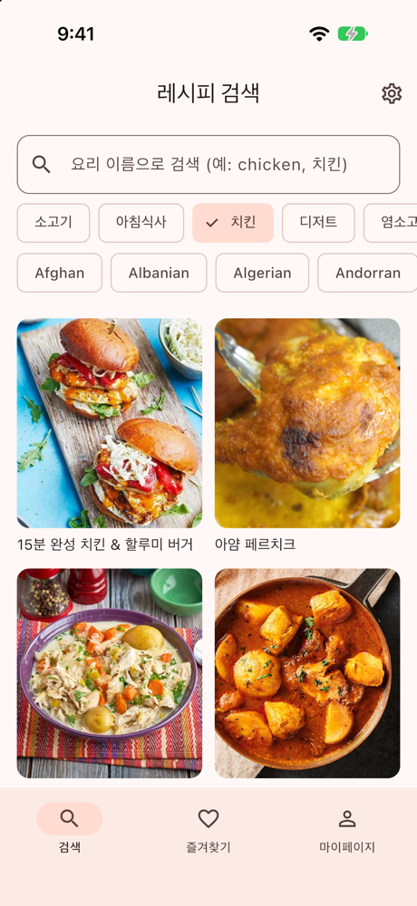
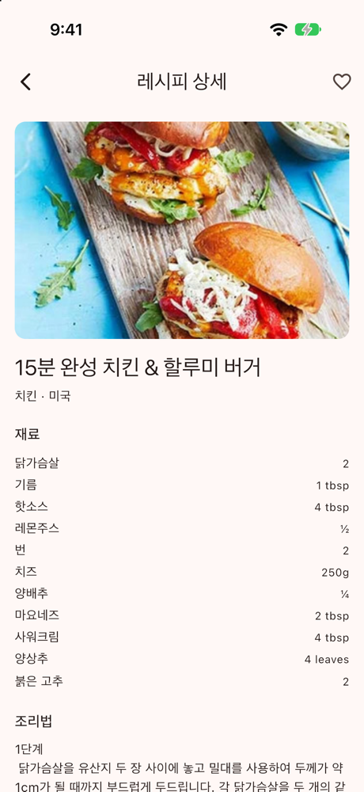

# 🍳 나의 레시피 (My Recipe)

TheMealDB 공개 API로 전 세계 요리 레시피를 검색하고, 즐겨찾기로 관리하는 Flutter 앱입니다.
한글 검색어와 조리법은 자동으로 번역되며, Google 로그인 시 Firebase로 프로필과 즐겨찾기가 기기 간에 동기화됩니다.

> 📄 **기술적 의사결정, 아키텍처, 트러블슈팅 등 상세 내용은 [docs/APP_INFO.md](docs/APP_INFO.md)를 참고해 주세요.**

## 스크린샷

| 카테고리 검색 결과 | 레시피 상세 (자동 번역) |
|:---:|:---:|
|  |  |

## 주요 기능

- 요리명 · 재료명 검색, 카테고리 · 지역(국가)별 필터
- 한↔영 자동 번역 (검색어, 레시피 이름, 조리법)
- Hive 기반 TTL 오프라인 캐시
- Google 로그인, Firestore 즐겨찾기 · 프로필 동기화
- 한국어/영어 지원

## 기술 스택

Dart · Flutter · Riverpod · Dio · Hive · Firebase Auth · Cloud Firestore · TheMealDB API · MyMemory Translation API

## 실행 방법

```bash
flutter pub get
flutter run
```

> Android release 빌드에는 `android/key.properties`와 키스토어가 필요합니다 (저장소에는 포함되지 않음).

## 문서

- [앱 상세 소개](docs/APP_INFO.md)
- [개인정보 처리방침](docs/privacy-policy.html)
- [이용약관](docs/terms-of-service.html)
